# Synchronisation de produits — Dagster, Python, PostgreSQL, Express

Pipeline ETL idempotent qui construit un catalogue de produits à partir
d'un export de ventes (`product_dataset.csv`), orchestré par Dagster,
avec contrôle qualité, historique des chargements, conservation des
lignes rejetées et une API Express.js en lecture seule pour consulter
le résultat.

Projet réalisé pour l'exercice 16 (« Synchronisation de données avec
Dagster, Python et PostgreSQL ») du module Développement à base de
composants et services web.

## 0. Compréhension du projet

`product_dataset.csv` est un export brut de ventes (542 000 lignes) :
doublons, prix négatifs, descriptions vides, références manquantes,
prix non numériques, dates invalides, lignes tronquées. Ce fichier
n'est pas utilisable tel quel par une application. Le projet transforme cette
source brute en un **catalogue de produits propre**, stocké dans
PostgreSQL et consultable via une API, avec la garantie que relancer
le traitement ne duplique rien, même en cas de panne en cours de
route.

Extraction, transformation et chargement sont trois fichiers séparés
(`etl/extraction.py`, `transformation.py`, `chargement.py`) parce que
ce sont trois responsabilités distinctes — lire le fichier, valider
chaque ligne, écrire le résultat — avec chacune ses propres erreurs
possibles. Les séparer permet de tester chacune isolément
(`tests/test_transformation.py`) et de corriger une étape sans toucher
aux deux autres.

Dagster orchestre ces trois étapes (`etl/definitions.py`). Son rôle
concret : exécuter extraction → transformation → chargement dans
l'ordre, afficher le résultat de chaque exécution dans une interface
web (http://localhost:3001), et rejouer automatiquement l'étape de
chargement si PostgreSQL renvoie une erreur temporaire (redémarrage,
connexion coupée), sans relancer tout le pipeline.

L'idempotence est la contrainte centrale du projet : relancer le même
fichier source, une ou dix fois, doit produire exactement le même
catalogue, sans doublon ni perte. `etl/chargement.py` l'obtient avec
un `UPSERT` (le produit est mis à jour s'il existe déjà, créé sinon) et
un identifiant d'exécution stable qui permet de retrouver le résultat
d'un chargement déjà validé plutôt que de le refaire. Raisonnement
complet dans [docs/strategie_reprise.md](docs/strategie_reprise.md).

L'API (`api/server.js`) sépare la consultation des données de leur
stockage : elle expose uniquement `/produits` et `/controles/dernier`
en lecture, sans donner à l'extérieur un accès direct à PostgreSQL.

PostgreSQL est démarré via Docker Compose (`docker-compose.yml`) pour
que l'installation soit la même sur Windows, macOS et Linux, et pour
éviter les conflits avec une installation PostgreSQL déjà présente sur
la machine — une seule commande (`docker compose up -d`) suffit.

Ce que le projet doit démontrer concrètement à la soutenance : le
pipeline complet qui tourne de bout en bout (extraction → Dagster →
PostgreSQL → API), une relance sans effet sur des données déjà
chargées, et une coupure de PostgreSQL pendant l'exécution suivie d'une
reprise automatique.

## 1. Architecture

```
product_dataset.csv
      |
      v
+-------------+     +------------------+     +--------------+
| extraction  | --> | transformation   | --> | chargement   |
| (etl/       |     | (etl/            |     | (etl/        |
|  extraction |     |  transformation. |     |  chargement. |
|  .py)       |     |  py)             |     |  py)         |
+-------------+     +------------------+     +------+-------+
      ^                                              |
      |                                              v
      |                                     +------------------+
      +---- orchestré par Dagster  -------- |   PostgreSQL     |
            (etl/definitions.py)            | produits         |
            reprise automatique sur         | etl_executions   |
            erreur PostgreSQL transitoire   | etl_rejets       |
                                             +--------+---------+
                                                       |
                                                       v
                                             +--------------------+
                                             | API Express.js     |
                                             | (api/server.js)    |
                                             | /sante /produits   |
                                             | /controles/dernier |
                                             +--------------------+
```

Chaque étape du pipeline est une opération Dagster (`@op`) assemblée
dans un seul job (`synchronisation_produits`). Dagster rejoue
automatiquement l'étape de chargement si PostgreSQL renvoie une erreur
transitoire (base en cours de redémarrage, connexion coupée, etc.) —
voir [docs/strategie_reprise.md](docs/strategie_reprise.md).

Le chargement est idempotent : relancer le même fichier source ne crée
ni doublon ni modification inutile (`INSERT ... ON CONFLICT DO
UPDATE`, comparaison des valeurs avant d'écrire).

## 2. Arborescence du dépôt

```
.
├── data/
│   └── product_dataset.csv  Source de données (export de ventes)
├── requirements.txt         Dépendances Python (Dagster, psycopg, ...)
├── .env.exemple              Modèle de configuration (copier en .env)
├── docker-compose.yml        PostgreSQL conteneurisé, pour installation rapide
│
├── etl/                      Pipeline ETL (Python)
│   ├── extraction.py            Lecture du CSV en flux, vérifie les colonnes attendues
│   ├── transformation.py        Valide chaque ligne, garde l'observation la plus récente par produit
│   ├── erreurs.py                Classifie une erreur PostgreSQL : transitoire (à rejouer) ou non
│   ├── chargement.py             UPSERT idempotent, verrouillage, historique, rejets
│   ├── base.py                   Ouvre la connexion PostgreSQL à partir de .env
│   └── definitions.py            Job Dagster : assemble extraction/transformation/chargement,
│                                  gère la reprise automatique sur erreur transitoire
│
├── sql/                      Scripts de création de la base
│   ├── 01_creation_tables.sql    Table produits (contraintes : référence/description non vides, prix >= 0)
│   └── 02_creation_suivi.sql     Tables etl_executions (historique) et etl_rejets (lignes invalides)
│
├── api/                      API Express.js (Node.js)
│   ├── server.js                 Routes /sante, /produits, /produits/:reference, /controles/dernier
│   ├── basededonnees.js          Classifie une erreur PostgreSQL côté API (pour renvoyer 503 ou 500)
│   ├── package.json
│   └── tests/
│       └── basededonnees.test.js Tests de la classification d'erreurs (node --test)
│
├── tests/                    Tests automatisés Python (unittest)
│   ├── test_transformation.py    Doublons, observation la plus récente, données invalides
│   ├── test_chargement.py        Insertion, modification, relance inchangée, reprise sur panne
│   └── test_erreurs.py           Classification des erreurs PostgreSQL transitoires
│
├── docs/
│   ├── strategie_reprise.md      Stratégie d'idempotence, d'atomicité et de reprise (détaillée)
│   └── openapi.yaml              Contrat de l'API (OpenAPI 3.0)
│
└── .github/workflows/tests.yml   CI : exécute tous les tests sur chaque push
```

## 3. Prérequis

- Docker et Docker Compose (v2, commande `docker compose`) — pour PostgreSQL
- Python 3.10+ (testé avec 3.10.10)
- Node.js 18+ (testé avec 20.19.5)
- Dagster 1.13.26 (installé via `requirements.txt`)

## 4. Installation

### 4.1 Démarrer PostgreSQL avec Docker Compose (toutes plateformes)

Depuis la racine du projet.

**Étape 1 — Créer le fichier de configuration**

Cette étape permet de définir, dans un fichier, l'hôte, le port, le
nom de la base, l'utilisateur et le mot de passe PostgreSQL.
`docker-compose.yml`, le pipeline Python (`etl/base.py`) et l'API
(`api/server.js`) fonctionnent tous les trois grâce aux variables
présentes dans ce fichier `.env` — c'est l'unique endroit où la
configuration existe.

Commande à exécuter :

```bash
cp .env.exemple .env
```

Résultat attendu : un nouveau fichier `.env` apparaît à la racine du
projet, copie de `.env.exemple`.

**Étape 2 — Renseigner le mot de passe**

Cette étape permet de fixer le mot de passe PostgreSQL utilisé par
Docker Compose, le pipeline et l'API.

Action à faire : ouvrir `.env` dans un
éditeur de texte et compléter `PGPASSWORD=` avec un mot de passe de
votre choix.

Format attendu : au moins 12 caractères, lettres et chiffres
uniquement (`A-Z`, `a-z`, `0-9`) — pas d'espace, de guillemet (`"` ou
`'`), de `#`, de `$`, de `\` ni d'accent. Exemple valide :
`monMotDePasse2026secure`.


**Étape 3 — Vérifier que le port 5432 est libre**

Cette étape permet de vérifire si le port 5432 de PostgreSQL est libre

Commande à exécuter :

```bash
# macOS / Linux
sudo lsof -i :5432
# Windows (PowerShell)
Get-NetTCPConnection -LocalPort 5432
```

Résultat et interprétation : si la commande ne retourne rien, le port
est libre, passez à l'étape suivante. Si elle retourne un processus, changez `PGPORT` dans `.env` (par exemple
`5433`) avant de continuer.

**Étape 4 — Démarrer le conteneur PostgreSQL**

Cette étape permet de lancer PostgreSQL, déjà configuré avec les
tables du projet.

Commande à exécuter :

```bash
docker compose up -d
```
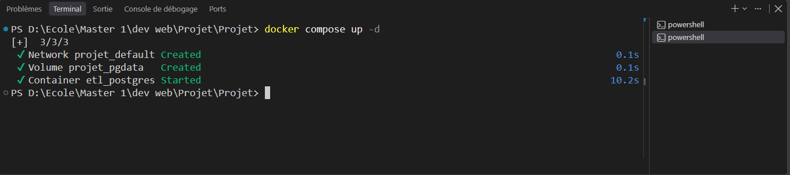

Ce que fait cette commande : elle lit `docker-compose.yml`, télécharge
l'image PostgreSQL 16 si besoin, et démarre le conteneur
`etl_postgres` en arrière-plan (`-d` = detached). Au tout premier
démarrage (volume `pgdata` vide), PostgreSQL crée automatiquement la
base `etl_produits` et le rôle `etl_user` d'après `.env`, puis exécute
une seule fois, `sql/01_creation_tables.sql`
puis `sql/02_creation_suivi.sql` — c'est ce qui crée les tables
`produits`, `etl_executions` et `etl_rejets`. Aux démarrages suivants,
le volume existe déjà : les scripts SQL ne sont pas rejoués et les
données sont conservées.

**Étape 5 — Vérifier que le conteneur est démarré**

Cette étape permet de confirmer que PostgreSQL est bien démarré avant
de passer à la suite.

Commande à exécuter :

```bash
docker compose ps
```

Résultat attendu, après quelques secondes :
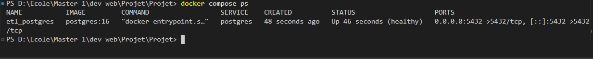

`(healthy)` signifie que PostgreSQL répond déjà aux connexions (le
`healthcheck` du `docker-compose.yml` sonde `pg_isready` toutes les
5 secondes).

**Étape 6 — Vérifier que la base accepte les connexions**

Cette étape permet de confirmer que la base `etl_produits` et le rôle
`etl_user` sont prêts à être utilisés par le pipeline et l'API.

Commande à exécuter :

```bash
docker compose exec postgres pg_isready -U etl_user -d etl_produits
```

Ce que fait cette commande : elle exécute `pg_isready` *à l'intérieur*
du conteneur, avec le rôle et la base de données etl_produits.

Résultat attendu :

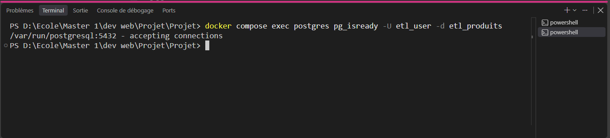

### 4.2 Installer le pipeline Python

**Étape 1 — Créer un environnement Python isolé**

Cette étape permet de créer un environnement Python isolé, séparé de
l'installation Python de la machine, dans lequel les dépendances du
projet (Dagster, psycopg...) seront installées à l'étape suivante.

Commande à exécuter :

```bash
# macOS / Linux
python3 -m venv .venv
# Windows (PowerShell)
python -m venv .venv
```

Ce que fait cette commande : `-m` dit à Python d'exécuter un module
intégré — ici `venv`, le module qui sait créer un environnement isolé
— et `.venv` est le nom du dossier où cet environnement est créé.

Résultat attendu : création du dossier `.venv/`.
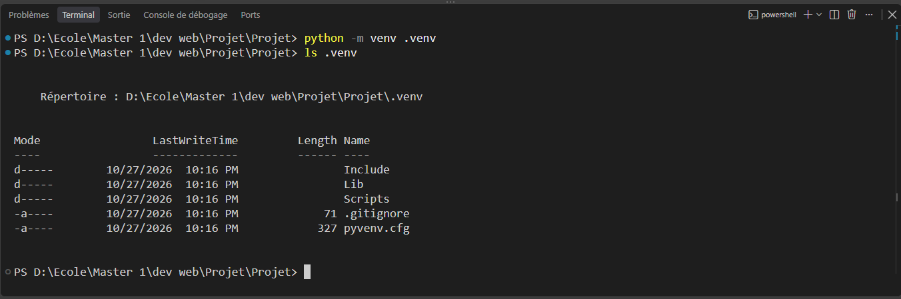
Pour vérifier son contenu  :

```bash
# macOS / Linux
ls -la .venv
# Windows (PowerShell)
ls .venv
```

Résultat attendu : `Scripts/` (Windows) ou `bin/` (macOS/Linux), `Lib/`
ou `lib/` (où les dépendances seront installées à l'étape 3), et
`pyvenv.cfg`.

**Étape 2 — Activer l'environnement**

Cette étape permet de faire en sorte que les commandes `python` et
`pip` utilisées ensuite pointent vers `.venv`, et non vers
l'installation Python globale de la machine.

Commande à exécuter :

```bash
# macOS / Linux
source .venv/bin/activate
# Windows (PowerShell)
.\.venv\Scripts\Activate.ps1
```

Résultat attendu : le prompt du terminal affiche désormais `(.venv)`
au tout début de la ligne.
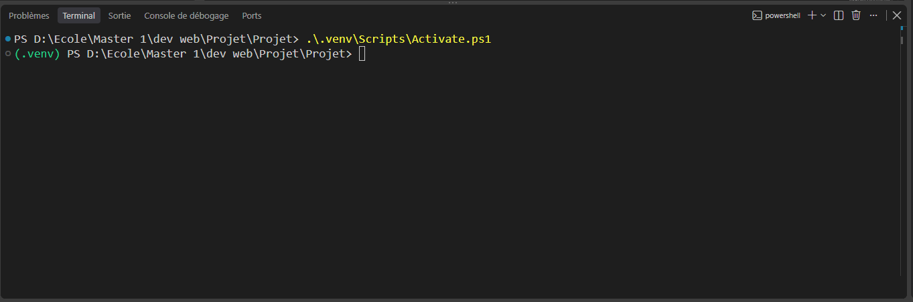

**Étape 3 — Installer les dépendances**

Cette étape permet d'installer dans `.venv` tout ce que le pipeline
nécessite, listé dans `requirements.txt`.

Commande à exécuter :

```bash
pip install -r requirements.txt
```

Résultat attendu : dure 1 à 2 minutes, se termine par une ligne du
type `Successfully installed dagster-1.13.26 ...`.
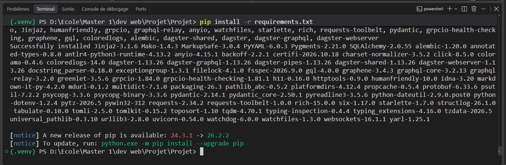

### 4.3 Installer l'API

**Étape 1 — Installer les dépendances Node.js**

Cette étape permet d'installer dans `api/node_modules/` tout ce dont
l'API a besoin (Express, pg, dotenv), listé dans `api/package.json`.

Commande à exécuter :

```bash
cd api
npm ci
```

Ce que fait cette commande : `npm ci` installe exactement les
versions verrouillées dans `api/package-lock.json`.

Résultat attendu : se termine par une ligne du type
`added 80 packages ...`.
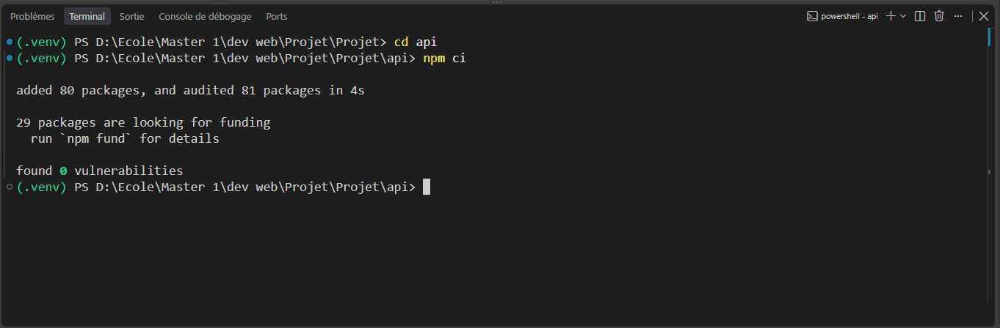

**Étape 2 — Revenir à la racine du projet**

Cette étape permet de préparer les sections suivantes, qui se lancent
depuis la racine.

Commande à exécuter :

```bash
cd ..
```

Résultat attendu : le prompt indique de nouveau le dossier racine du
projet.

## 5. Démarrer le pipeline

Dans un terminal, à la racine du projet.

**Étape 1 — Créer le dossier d'état de Dagster**

Cette section permet de préparer l'endroit où Dagster va écrire
l'historique des exécutions, les logs de chaque étape, et les copies
du CSV traité (voir `docs/strategie_reprise.md`). Ce dossier n'est pas
versionné (`.gitignore`).

Commande à exécuter :

```bash
# macOS / Linux
mkdir -p .dagster
# Windows (PowerShell)
New-Item -ItemType Directory -Path .dagster -Force
```

Résultat attendu : un dossier `.dagster/` apparaît à la racine du
projet.
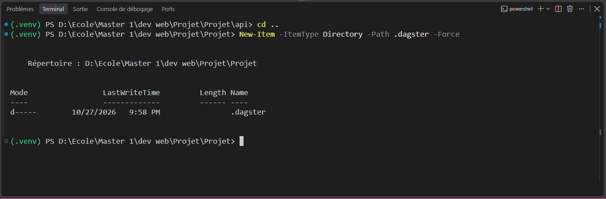

**Étape 2 — Indiquer ce dossier à Dagster**

Cette section permet d'indiquer à Dagster où se trouve son dossier
d'état. Sans cette variable, Dagster refuse de démarrer (ou utilise un
dossier temporaire perdu à chaque relance).

Commande à exécuter :

```bash
# macOS / Linux
export DAGSTER_HOME="$(pwd)/.dagster"
# Windows (PowerShell)
$env:DAGSTER_HOME = (Resolve-Path .dagster).Path
```

Résultat attendu : aucune sortie ; la variable est active pour la
suite du terminal en cours uniquement.
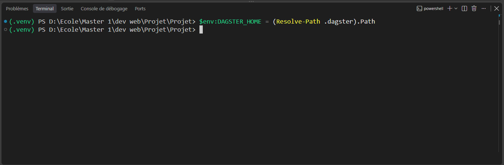

**Étape 3 — Démarrer Dagster**

Cette section permet de lancer l'orchestrateur et son interface web de
suivi.

Commande à exécuter :

```bash
# macOS / Linux
dagster dev -m etl.definitions -p 3001
# Windows (PowerShell)
.\.venv\Scripts\dagster.exe dev -m etl.definitions -p 3001
```

Ce que fait cette commande : `dagster` ou `.\.venv\Scripts\dagster.exe` est le programme qu'on exécute,
et `dev` est son sous-programme qui démarre une interface web locale
de suivi, en plus de pouvoir exécuter les jobs. `-m etl.definitions`
indique où trouver le code du pipeline : `-m` signifie « charge ceci
comme un module Python », et `etl.definitions` pointe vers le fichier
`etl/definitions.py`, où le job `synchronisation_produits` est défini.
`-p 3001` fixe le port sur lequel l'interface web sera accessible. En
résumé, cette commande démarre l'interface de suivi de Dagster, lui
charge le pipeline défini dans `etl/definitions.py`, et rend cette
interface accessible sur le port 3001.

Résultat attendu dans le terminal :
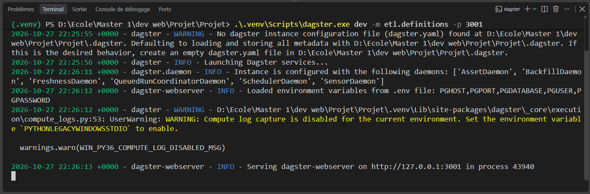

Conserver ce terminal ouvert tant que l'interface Dagster doit rester
accessible.

**Étape 4 — Lancer le pipeline depuis l'interface**

Cette section permet d'exécuter réellement le pipeline : extraction → transformation → chargement.

Action à faire (dans le navigateur) : ouvrir directement
http://localhost:3001/jobs (cette page liste les jobs disponibles, pas
les exécutions passées). Cliquer sur `synchronisation_produits`, puis
sur l'onglet **« Launchpad »**, puis sur le bouton en bas à droite
**« Launch Run »**.


Ce que fait chaque étape, dans l'ordre :

- **`extraire_source`** — copie `data/product_dataset.csv` dans
  `.dagster/sources/` et calcule son empreinte SHA-256, pour pouvoir
  détecter si le fichier change pendant le traitement.
- **`transformer_source`** — lit cette copie, valide chaque ligne et
  ne garde que l'observation la plus récente par produit ; elle donne 3 résultats : la liste des produits valides, la liste des lignes
  rejetées (avec leur motif), et un bilan chiffré (lignes extraites,
  valides, rejetées...).
- **`charger_destination`** — écrit ce résultat dans PostgreSQL
  (tables `produits`, `etl_executions`, `etl_rejets`), avec la logique
  d'idempotence et de reprise.

Résultat attendu : l'exécution apparaît avec ces trois étapes ; un
statut vert `SUCCESS` sur chacune signifie que le pipeline a chargé
les produits dans PostgreSQL.
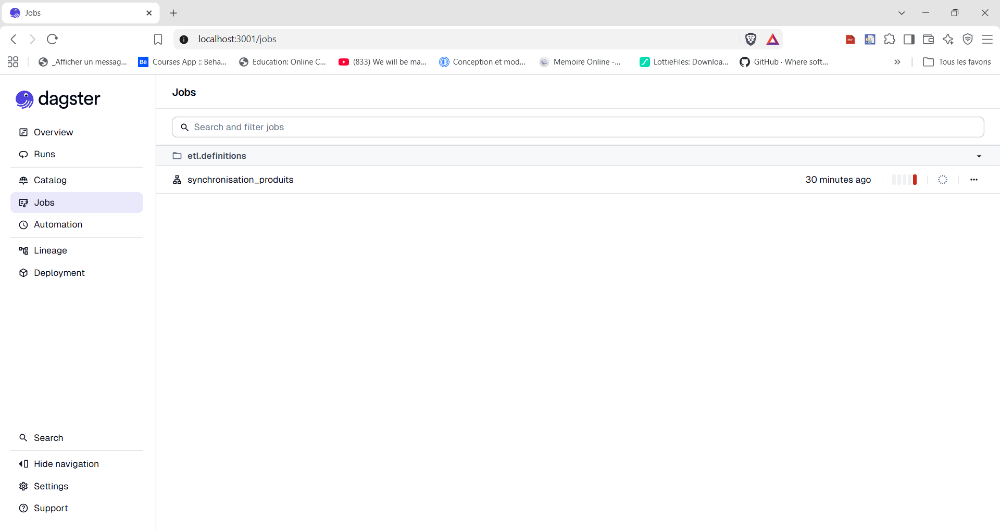
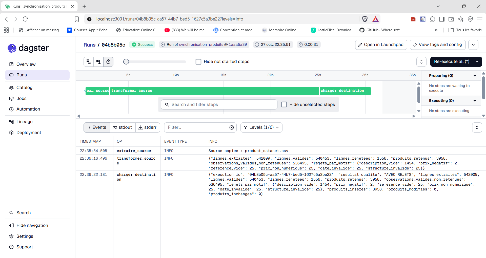

**Voir la sortie de chaque étape** : Pour voir le résultat de façon lisible, plusieurs façons, toutes dans l'interface Dagster :
- dans l'onglet **« Events »** de la page de l'exécution, cliquer sur
  le filtre **« Levels »** et ne cocher que **« info »** : chaque
  étape a enregistré son bilan en JSON à ce niveau (lignes extraites,
  rejets par motif, produits insérés/modifiés/inchangés...), visible
  directement dans la colonne INFO sans avoir besoin d'ouvrir un
  fichier ;
- ou consulter le résultat final, dans PostgreSQL : table `produits` pour le
  catalogue, `etl_executions` pour le bilan de cette exécution. Depuis
  un terminal, à la racine du projet :

  ```bash
  docker compose exec postgres psql -U etl_user -d etl_produits -c "SELECT reference, description, prix_unitaire FROM produits;"
  docker compose exec postgres psql -U etl_user -d etl_produits -c "SELECT id, resultat_qualite, bilan FROM etl_executions ORDER BY fin DESC LIMIT 1;"
  ```
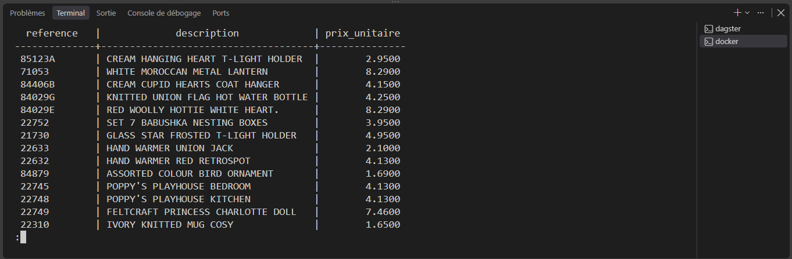
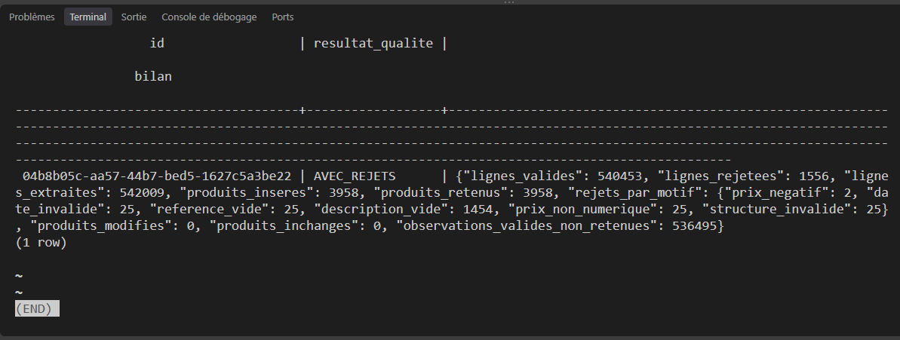

  Ce que fait chaque commande : `docker compose exec postgres psql ...`
  ouvre une connexion `psql` à l'intérieur du conteneur et exécute la
  requête donnée après `-c`. La première affiche la listes des produits
  du catalogue ; la seconde affiche le bilan complet
  (en JSON) la dernière exécution enregistrée.

## 6. Démarrer l'API

Dans un second terminal (le premier reste occupé par Dagster), à la
racine du projet.

**Étape unique — Démarrer le serveur Express**

Cette section permet d'exposer les données chargées par le pipeline
sur des routes HTTP consultables (voir §7).

Commande à exécuter :

```bash
cd api
node server.js
```

Ce que fait cette commande : démarre le serveur Express défini dans
`api/server.js`, qui se connecte à PostgreSQL avec les identifiants de
`.env`.

Résultat attendu dans le terminal :

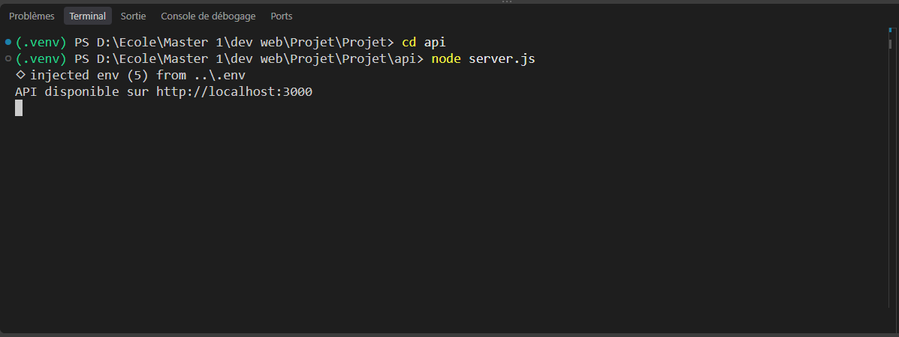

Si cette ligne n'apparaît pas :
- une erreur mentionne `Configuration manquante` → le fichier `.env`
  n'existe pas ou est incomplet (§4.1) ;
- une erreur mentionne `Cannot find module 'express'` → l'étape
  `npm ci` (§4.3) n'a pas été faite.

## 7. Routes de l'API

Contrat complet dans [docs/openapi.yaml](docs/openapi.yaml) (format
OpenAPI 3.0 : liste des routes, paramètres, réponses possibles).

**Voir ce contrat sous forme de page web (Swagger UI)** : l'API
elle-même l'expose. Une fois l'API
démarrée (§6), ouvrir :

[http://localhost:3000/docs](http://localhost:3000/docs)

La page affiche chaque route avec ses paramètres, ses réponses
possibles (200, 400, 404, 503...) et un bouton `Try it out` pour
l'essayer directement contre l'API en cours d'exécution.

| Route | Fonction | Codes possibles |
|---|---|---|
| GET /sante | Vérifier l'accès à PostgreSQL | 200, 503 |
| GET /produits?page=1&limite=20 | Lister les produits (pagination 1-100) | 200, 400, 503 |
| GET /produits/:reference | Consulter un produit | 200, 404, 503 |
| GET /controles/dernier | Consulter le dernier contrôle de chargement | 200, 404, 503 |

503 signifie que PostgreSQL est temporairement indisponible ; l'API
retrouve une connexion automatiquement dès que la base répond à
nouveau (voir `api/basededonnees.js`).

**Tester les routes** : dans un nouveau terminal (l'API doit être démarer).

```bash
# 200 — l'API et PostgreSQL répondent
curl http://localhost:3000/sante
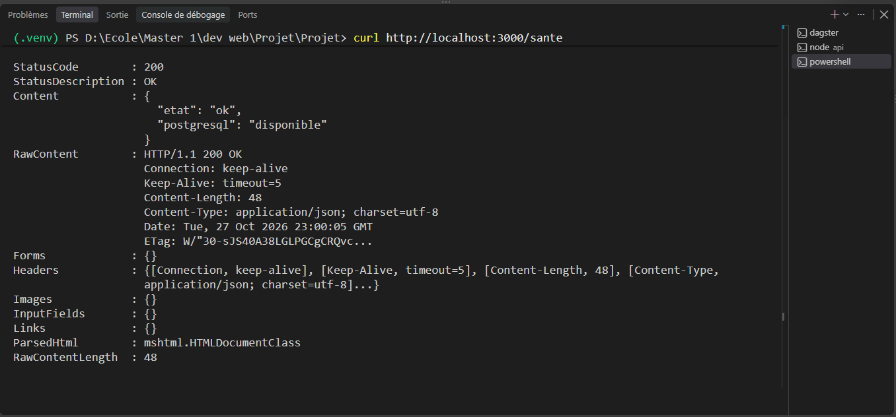

# 200 — les 3 premiers produits
curl "http://localhost:3000/produits?page=1&limite=3"
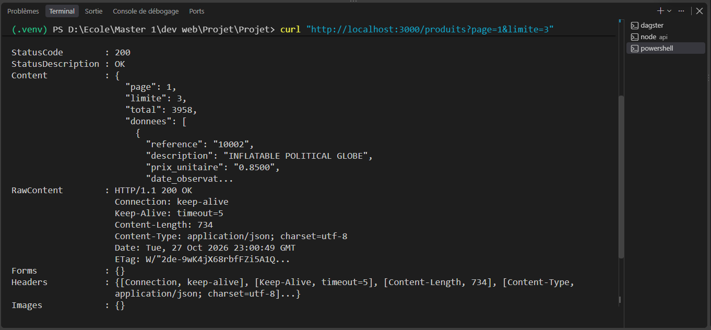

# 200 — un produit précis 
curl http://localhost:3000/produits/85123A
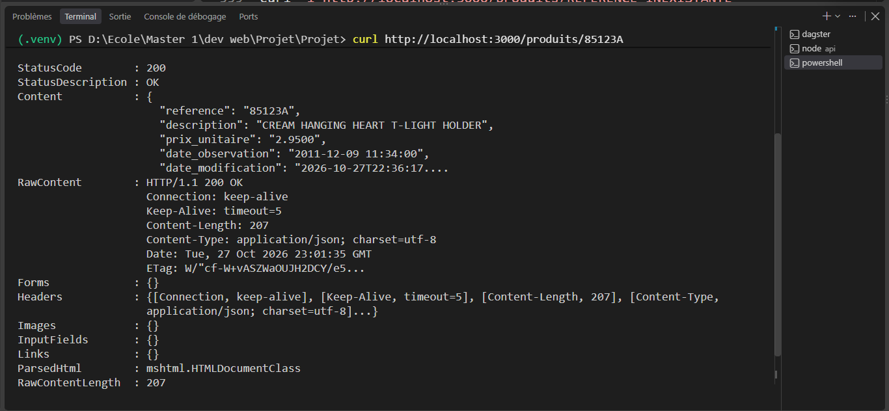

# 404 — référence qui n'existe pas
# macOS / Linux
curl -i http://localhost:3000/produits/REFERENCE_INEXISTANTE
# Windows (PowerShell)
curl.exe -i http://localhost:3000/produits/REFERENCE_INEXISTANTE
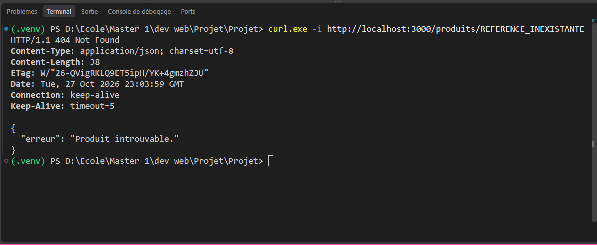

# 400 — page invalide (0 n'est pas un entier positif)
# macOS / Linux
curl -i "http://localhost:3000/produits?page=0"
# Windows (PowerShell)
curl.exe -i "http://localhost:3000/produits?page=0"
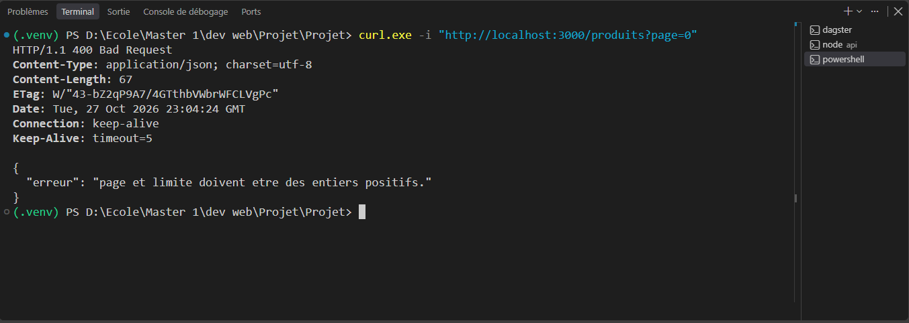

# 200 — bilan du dernier chargement effectué par Dagster
curl http://localhost:3000/controles/dernier
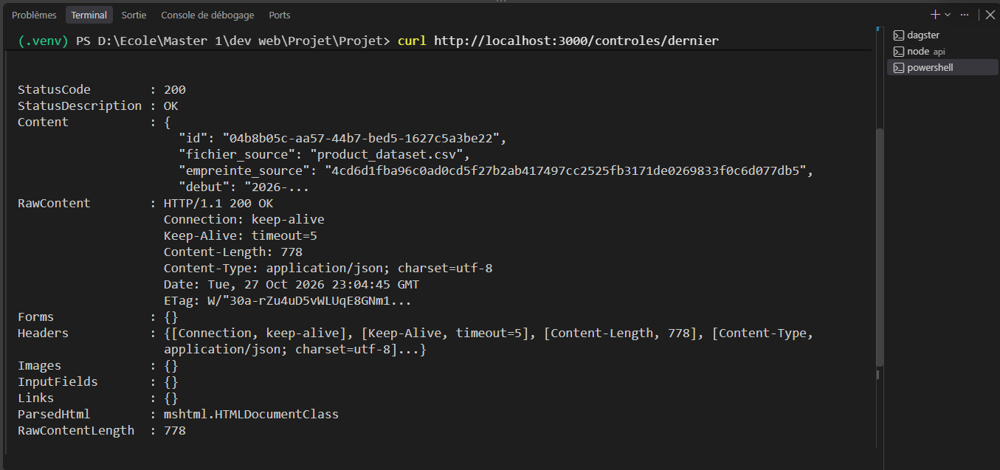
```

Ce que fait `curl` : il envoie une requête HTTP à l'URL donnée et
affiche la réponse dans le terminal. L'option `-i` ajoute l'en-tête de
la réponse (dont le code HTTP, par exemple `HTTP/1.1 404 Not Found`)
avant le corps JSON — utile pour vérifier précisément le code renvoyé,
pas seulement le contenu.


Résultat attendu : chaque commande renvoie du JSON (sauf les deux
`-i`, qui affichent d'abord le code HTTP) correspondant aux codes du
tableau ci-dessus.

## 8. Tests automatisés

**Étape 1 — Lancer les tests Python**

Cette section permet de vérifier automatiquement la transformation,
l'idempotence du chargement et la classification des erreurs
PostgreSQL. Nécessite PostgreSQL démarré (`docker compose up -d`,
§4.1).

Commande à exécuter :

```bash
python -m unittest discover -s tests -p "test_*.py" -v
```

Ce que fait cette commande : `unittest discover` trouve et exécute
tous les fichiers `tests/test_*.py` ; `-v` (verbose) affiche, pour
chaque test, son nom, le but du test, ce qu'il envoie en entrée et ce qu'il obtient en sortie, puis `ok`. Extrait réel de la sortie, pour un seul test :

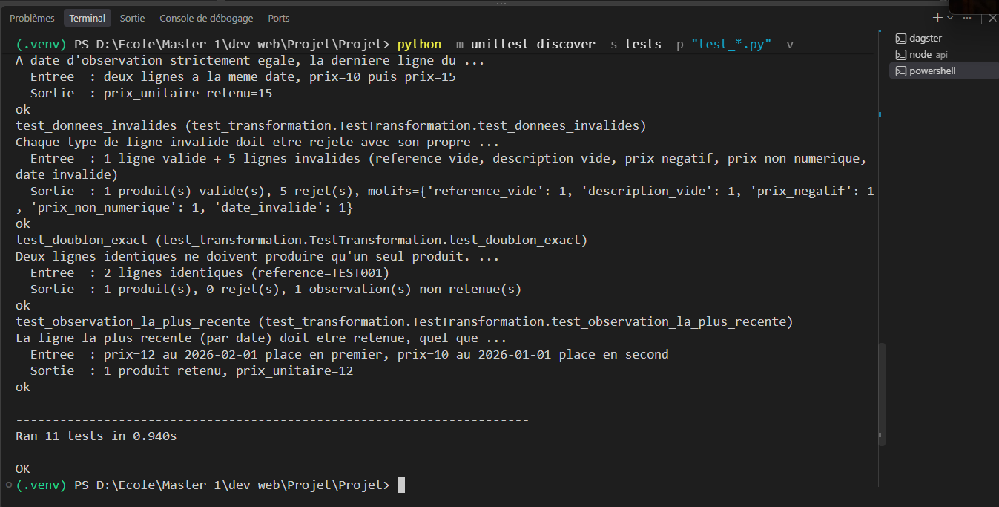

```
test_derniere_ligne_a_date_egale (tests.test_transformation...)
A date d'observation strictement egale, la derniere ligne du ...

  Entree  : deux lignes a la meme date, prix=10 puis prix=15
  Sortie  : prix_unitaire retenu=15
ok
```

Et en bas de la sortie complète (le résumé global sur les 11 tests) :

```
Ran 11 tests in 0.3s

OK
```

Si un test échoue, le mot `OK` final est remplacé par `FAILED`, et le
détail de l'échec (valeur attendue vs valeur obtenue) s'affiche
au-dessus, juste après l'entrée/sortie que le test a lui-même
imprimée.

Ce que vérifie chacun des 11 tests, un par un (dans l'ordre où `-v`
les affiche) :

`tests/test_transformation.py` (4 tests — doublons, règles de
validation) :

| Test | Ce qu'il vérifie |
|---|---|
| `test_doublon_exact` | Deux lignes identiques dans la source ne produisent qu'un seul produit |
| `test_observation_la_plus_recente` | Entre deux observations du même produit, celle avec la date la plus récente est conservée, quel que soit son ordre dans le fichier |
| `test_derniere_ligne_a_date_egale` | À date d'observation strictement égale, c'est la dernière ligne du fichier qui est retenue |
| `test_donnees_invalides` | Les 5 motifs de rejet synthétisables (référence/description vide, prix négatif/non numérique, date invalide) sont chacun détectés et comptés séparément |

`tests/test_chargement.py` (1 test — idempotence réelle en base) :

| Test | Ce qu'il vérifie |
|---|---|
| `test_insertion_modification_et_reprises` | Un enchaînement complet : insertion d'un produit, modification de son prix, relance strictement inchangée (0 insertion/0 modification), puis reprise avec le même `execution_id` (simule une confirmation perdue après coupure réseau) renvoie le même résultat sans rejouer l'écriture |

Ce test écrit des données temporaires (préfixées `TEST_`) dans la base
configurée, puis les supprime à la fin du test.

`tests/test_erreurs.py` (6 tests — classification des erreurs
PostgreSQL à rejouer ou non) :

| Test | Ce qu'il vérifie |
|---|---|
| `test_sans_code_est_reessayable` | Une erreur sans code SQLSTATE (connexion jamais établie) est considérée comme transitoire |
| `test_classe_connexion_est_reessayable` | Les codes de la classe `08` (erreurs de connexion) sont considérés comme transitoires |
| `test_base_indisponible_est_reessayable` | Les codes `57P01`/`57P02`/`57P03`/`53300` (base en cours d'arrêt/démarrage, trop de connexions) sont considérés comme transitoires |
| `test_conflit_concurrent_est_reessayable` | Les codes `40001`/`40P01` (conflit de mise à jour, deadlock) sont considérés comme transitoires |
| `test_erreur_de_contrainte_nest_pas_reessayable` | Une violation de contrainte (`23505`) n'est **pas** rejouée — rejouer ne changerait rien |
| `test_erreur_de_syntaxe_nest_pas_reessayable` | Une erreur de syntaxe SQL (`42601`) n'est **pas** rejouée non plus |

**Étape 2 — Lancer les tests de l'API**

Cette section permet de vérifier la classification des erreurs côté
API.

Commande à exécuter :

```bash
cd api
npm test
```

Ce que fait cette commande : lance `node --test tests/` (défini dans
`api/package.json`), le testeur intégré à Node.js.

Résultat attendu :
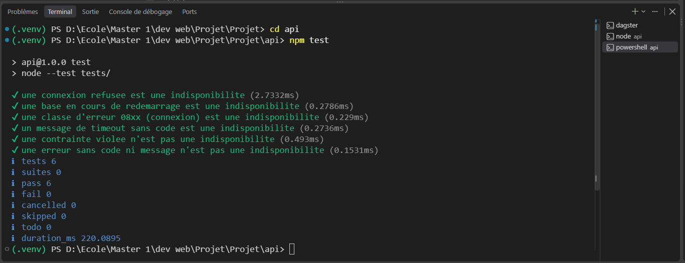

**Intégration continue** : à chaque `git push`,
`.github/workflows/tests.yml` répète automatiquement ces deux
commandes (tests Python et tests de l'API) sur une machine
GitHub, avec un PostgreSQL démarré — c'est la preuve
que l'installation documentée ici fonctionne vraiment sur une machine
neuve.

## 9. Scénario de bout en bout

1. `docker compose up -d` puis vérifier `docker compose exec postgres pg_isready -U etl_user -d etl_produits`.
2. Démarrer Dagster (§5) et lancer le job `synchronisation_produits`.
3. Vérifier dans les logs Dagster le bilan : lignes extraites, lignes
   rejetées, produits insérés/modifiés/inchangés.
4. Démarrer l'API (§6) et appeler :
   - `GET /controles/dernier` → doit renvoyer le bilan de l'étape 3
   - `GET /produits?page=1&limite=5` → doit renvoyer des produits
5. Relancer le même job Dagster sans rien changer : le bilan doit
   afficher 0 insertion et 0 modification (idempotence).
6. Couper PostgreSQL (`docker compose stop postgres`) pendant un appel
   à `GET /sante` → réponse 503. Redémarrer
   (`docker compose start postgres`) → l'appel suivant renvoie 200.

### Résultats observés sur la source fournie

- 542 009 lignes extraites, 540 453 valides, 1 556 rejetées
- 3 958 produits retenus
- Les 6 motifs de rejet sont tous représentés : `description_vide`
  (1 454), `prix_negatif` (2), `reference_vide` (25),
  `prix_non_numerique` (25), `date_invalide` (25), `structure_invalide`
  (25)
- Une relance du même fichier : 0 insertion, 0 modification, 3 958
  produits inchangés

## 10. Reprise et contrôle qualité

Stratégie détaillée (idempotence, atomicité, reprise automatique et
manuelle) dans [docs/strategie_reprise.md](docs/strategie_reprise.md).
Un chargement techniquement réussi peut renvoyer le résultat qualité
`AVEC_REJETS` : les lignes invalides sont mises de côté, pas
bloquantes.

## 11. Dépannage

**Problème : `FATAL: password authentication failed` alors que le mot
de passe dans `.env` est correct** (y compris si ça arrive au milieu
d'une exécution Dagster, après plusieurs tentatives de reprise
automatique).

Cause probable : un autre PostgreSQL occupe déjà le port 5432 et
répond à la place du conteneur — Docker Compose ne le détecte pas
lui-même et démarre sans erreur dans ce cas (voir §4.1, étape 3, où
cette vérification est faite *avant* de démarrer, pour éviter d'en
arriver là). Si ce problème apparaît malgré tout, refaire la
vérification de l'étape 3 et changer `PGPORT` dans `.env` si un autre
processus occupe le port.

**Problème : le mot de passe vient d'être changé dans `.env`, mais
l'erreur d'authentification persiste.**

Cause : le mot de passe PostgreSQL n'est appliqué qu'à la toute
première création du volume `pgdata` ; le changer dans `.env` après
coup ne met pas à jour la base déjà créée.

Commande à exécuter :

```bash
docker compose down -v
docker compose up -d
```

Résultat attendu : un volume `pgdata` neuf est créé avec le nouveau
mot de passe (les tables sont recréées, vides).

**Problème : `Cannot find module 'express'` au démarrage de l'API.**

Cause : l'étape `npm ci` (§4.3) n'a pas été exécutée dans `api/`.

## 12. Arrêt

**Étape 1 — Arrêter Dagster et l'API**

Dans chacun des deux terminaux concernés : `Ctrl+C`.

**Étape 2 — Arrêter PostgreSQL**

Cette section permet de choisir entre garder les données pour la
prochaine fois, ou repartir de zéro.

Pour arrêter sans perdre les données (les produits déjà chargés et
l'historique restent disponibles au prochain `docker compose up -d`) :

```bash
docker compose stop
```

Pour arrêter et tout effacer (la base repart de zéro, tables vides, au
prochain `docker compose up -d`) — utile par exemple après avoir
changé le mot de passe dans `.env` (§11) :

```bash
docker compose down -v
```
